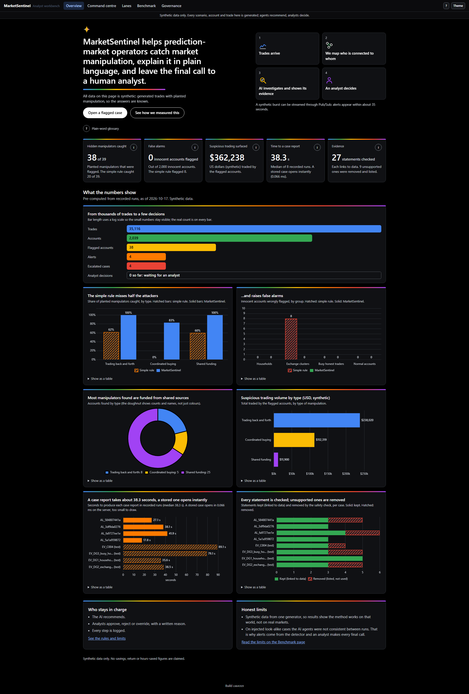
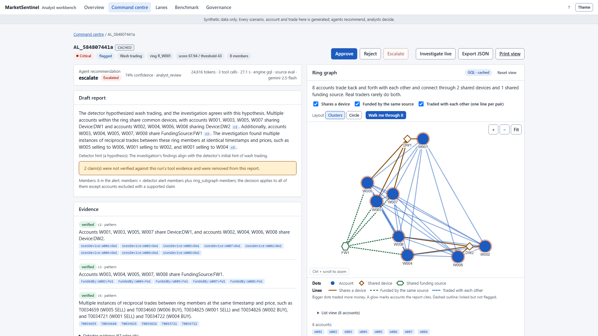
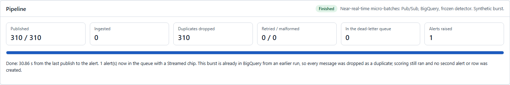
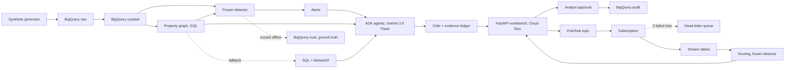

# MarketSentinel

MarketSentinel helps prediction-market operators catch market manipulation, explains each case in plain
language with evidence, and leaves the final decision to a human analyst. Built for the Google Cloud AI
Builder Cup 2026 (BFSI track). **All data is synthetic.**

- Live app: https://sentinel-app-578558579917.us-central1.run.app
- Video: VIDEO_URL_TODO
- Slides: DECK_URL_TODO

**60-second tour** (open the live app):

1. **Overview**: the problem, four steps, and simple rule versus MarketSentinel.
2. Press **Open a flagged case** (or the top row in Command centre): a ring of 8 accounts, its graph and evidence.
3. Press **Walk me through it** on the graph: a guided replay of how the evidence links.
4. In Command centre press **Stream a scenario**: messages move through the pipeline (see "Streaming", it is a replay).
5. **Governance**: what is checked, what is capped, and what is not built.

| Overview | Case graph | Pipeline card |
|---|---|---|
|  |  |  |

## The problem and who it is for

Operators of prediction markets and their compliance analysts must spot accounts that trade with each other
to fake volume, buy together just before a market resolves, or are funded from one shared source. Simple
rules (for example, "many accounts share a funding source") miss disguised rings and flag innocent groups
such as households and exchange wallets.

MarketSentinel works in four steps:

1. **Trades arrive** (synthetic data here).
2. **We map who is connected to whom**: shared devices, shared funding, trades between accounts.
3. **AI investigates and shows its evidence**: agents write a case report; a Critic removes any claim the evidence does not support.
4. **An analyst decides**: approve, reject or override, with a written reason, all logged.

## Results at a glance

Synthetic benchmark, seed 42 (2,039 accounts, 39 planted attackers, 23 innocent decoy accounts).
Threshold 43.0, chosen on other seeds and frozen before seed 42 was scored. Full tables: [docs/benchmark.md](docs/benchmark.md).

| Group | Simple rule: precision / recall / F1 | MarketSentinel detector: precision / recall / F1 |
|---|---|---|
| All scenarios | 71% / 51% / 60% | 100% / 97% / 99% |
| Wash trading | 38% / 62% / 48% | 100% / 100% / 100% |
| Coordinated buying | 0% / 0% / 0% | 100% / 83% / 91% |
| Mule funding | 65% / 60% / 63% | 100% / 100% / 100% |

Innocent groups wrongly flagged (simple rule / detector): household 0 / 0, exchange cluster 8 / 0, busy honest traders 0 / 0.

- **Ablation:** on eight robustness seeds the full detector scores F1 98% to 100%; graph features alone 89% to 100%, behavior features alone 72% to 93%, device and funding components only 50% to 92%, the simple funding rule 43% to 74%.
- **Robustness (8 other synthetic worlds, same frozen threshold):** detector precision 100%, recall 95% to 100% (median 98%); simple rule precision 50% to 76%, recall 24% to 73%.
- **Caveats:** one generator and one project produced the scenarios, decoys and detector, so this shows the method works on that world and says nothing about real markets; the margin is thin (on two robustness seeds the strongest innocent account outscored the weakest attacker). See [docs/benchmark.md](docs/benchmark.md#caveats).

**Agent layer** (details: [docs/agent-evals.md](docs/agent-evals.md), [docs/injected-rerun.md](docs/injected-rerun.md)). Real alerts come from the detector, which flagged none of the 23 decoy accounts. To test the agents alone, decoy groups were injected as review cases. Agent decisions on them were unstable:

| Run | Decoy groups falsely escalated | Borderline attacker escalated |
|---|---|---|
| First run, 2026-10-16 | 0 of 3 groups (0 of 23 accounts) | 0 of 1 |
| Re-run, 2026-10-17 | 2 of 3 groups (18 of 23 accounts, plus 6 linked accounts) | 1 of 1 |

Neither row is a stable rate; a repeated run was not done. In the first run the agents escalated all 4 real alerts (39 of 39 attackers covered), and the Critic rejected 3 of 3 injected unsupported claims. The agents explain, the Critic blocks unsupported claims, humans decide.

## Architecture



The generator fills BigQuery. A property graph links accounts by device, funding source and trades; if the
graph query engine is unavailable a SQL plus NetworkX fallback answers the same questions. The frozen detector
scores accounts and raises alerts. ADK agents on Gemini 2.5 Flash investigate an alert with read-only graph tools;
the Critic and evidence ledger drop unsupported claims; the analyst approves or rejects in the workbench and every step
is written to the audit dataset. The stream path publishes a synthetic burst to Pub/Sub, validates and ingests it
idempotently, and scores it with the same detector. The eval dataset holds ground truth; only evaluation code reads it, never the detector.
More: [docs/architecture.md](docs/architecture.md).

## How Google Cloud and Gemini are used

| Component | Google service | Role | Proof |
|---|---|---|---|
| Data store, curated tables, audit | BigQuery | Raw, curated, eval and audit datasets | [sql/schema/10_risk_raw.sql](sql/schema/10_risk_raw.sql) |
| Relationship graph | BigQuery property graph, GQL | Accounts linked by device, funding and trades | [sql/graph/market_graph.sql](sql/graph/market_graph.sql), [services/graph/engines.py](services/graph/engines.py) |
| Detector | BigQuery SQL | Features and scores, run as SQL | [sql/views/det_40_features.sql](sql/views/det_40_features.sql), [services/detector/scoring.py](services/detector/scoring.py) |
| Investigation agents | Gemini 2.5 Flash on Vertex AI, Agent Development Kit | Investigator, Critic, Drafter | [services/app/agents.py](services/app/agents.py), [services/app/config.py](services/app/config.py) |
| Workbench and API | Cloud Run | One public service, one instance, runs as `sa-agent` | [infra/deploy_app.py](infra/deploy_app.py) |
| Streaming | Pub/Sub | Topic, subscription, dead-letter queue | [services/stream/service.py](services/stream/service.py), [infra/stream_setup.py](infra/stream_setup.py) |
| Images | Artifact Registry, Cloud Build | Built by the deploy script | [infra/app/Dockerfile](infra/app/Dockerfile) |
| Least privilege | IAM | Table-level write grants for `sa-agent` | [sql/iam/sa_agent_stream_tables.sql](sql/iam/sa_agent_stream_tables.sql) |

## Streaming

Streaming is a **near-real-time micro-batch** path: Pub/Sub, schema validation, an idempotent consumer, a
dead-letter queue, and scoring with the frozen detector. On Cloud Run each press of "Stream a scenario"
re-sends message ids that an earlier validation run already ingested, so a visitor sees "ingested 0,
duplicates dropped 310" and, 27.2 to 34.3 seconds later (three earlier Cloud Run runs), the same ring alert id
flagged again; the household is not flagged. So the demo shows an idempotency and exactly-once
demonstration with a dead-letter queue. "Send a bad message" shows retries and a dead-letter entry. The ring
scored 44.37 against the threshold 43.0 on one burst: this shows the pipeline works and says nothing about precision or recall.
Deployed revision: `sentinel-app-00013-tek`. Details: [docs/architecture.md](docs/architecture.md).

## Governance and safety

Built and active: evidence ledger (a claim stays only if its evidence ids came from tools in the same run), a
number check, an LLM Critic with one send-back, an escalation guard, analyst approval with a written reason and an
audit log, rate limits, and per-run caps of 8 tool calls and 120 seconds with token budgets. Agents take no action
on accounts. Not built: Model Armor, any prompt-injection guard, PII redaction, Vertex AI Search (retrieval is
keyword-based). There is no sign-in: analyst names are free text.

## Implemented vs planned

| Item | Status |
|---|---|
| Synthetic generator, BigQuery datasets, property graph with GQL and fallback | Implemented |
| Frozen detector and benchmark | Implemented |
| ADK agents, Critic, evidence ledger, analyst approval, audit | Implemented |
| Workbench on Cloud Run | Implemented (revision `sentinel-app-00013-tek`) |
| Pub/Sub micro-batch path with dead-letter queue | Implemented, one burst evaluated |
| Model Armor or a prompt-injection guard, PII redaction | Not built |
| Vertex AI Search retrieval, real market data ingestion | Not built |
| Workload Identity deploy pipeline, shared state across instances | Planned ([docs/ci-deploy.md](docs/ci-deploy.md)) |

## Where to look

| Criterion | Look at |
|---|---|
| Technical merit and Gen AI | Case page evidence chips and removed claims; [services/app/critic.py](services/app/critic.py), [services/app/pipeline.py](services/app/pipeline.py); [docs/agent-evals.md](docs/agent-evals.md) |
| Problem alignment and impact | Overview charts; [docs/benchmark.md](docs/benchmark.md); [data/policies/surveillance_policy.md](data/policies/surveillance_policy.md) |
| Innovation | Graph walkthrough on the case page; [sql/graph/market_graph.sql](sql/graph/market_graph.sql); decoys and evasions ([docs/adr/0002-decoys-and-evasions.md](docs/adr/0002-decoys-and-evasions.md)) |
| User experience | Command centre, Lanes, approve with a reason; [docs/demo-script.md](docs/demo-script.md) |

## Repository map

```
services/app       FastAPI service, ADK agents, Critic, analyst workbench (static/)
services/detector  frozen detector      services/graph   graph tools (GQL + fallback)
services/stream    Pub/Sub path         services/ingest  synthetic data generator
sql/               DDL, property graph, detector SQL, IAM grants
infra/  scripts/   deploy and tooling   evals/ data/     evaluation and synthetic data
docs/              status, benchmark, setup, architecture, demo script, results, images
```

Every folder and where the original plan's "agents", "risk" and "web" ended up: [docs/repo-map.md](docs/repo-map.md).

## Quick start

Each step shows the date it was last run (2026-10-18).

- **(a) Just open the live app** (run 2026-10-18): the URL above. No install.
- **(b) Run locally** (run 2026-10-18, partly): see [docs/setup.md](docs/setup.md). Needs Python 3.12 and Google credentials with read access to the project's BigQuery data; the page data comes from BigQuery.
- **(c) Run the tests** (run 2026-10-18): `pip install -e ".[dev,app]"`, then `ruff check . && pytest`.
- **(d) Regenerate the data and check sync** (run 2026-10-18): `python -m services.ingest.synth --seed 42` (writes local files, dry run), then `python scripts/verify_sync.py --no-query` (read-only, needs credentials).
- **(e) Deploy** (dry run only, 2026-10-18): `python infra/deploy_app.py` prints the plan; `--apply` builds and deploys and was not run for this release.

## Cost and teardown

The reservation `gql-poc` is assigned to the whole project, so every query uses slots; the service runs one instance
with minimum 1 while judging. Teardown after Nov 6 is in [docs/submission-checklist.md](docs/submission-checklist.md).

## Honest limits

Synthetic data from one generator; the result says the method works there, not on real markets. Agent decisions on
injected decoys were unstable. Streaming is a replay and one burst. Retrieval is keyword-based. The public URL
has no sign-in. State is per instance.
`feat/stream-fresh` (fresh-burst streaming) is unverified, not deployed and not merged.

## License, team, issues

MIT, see [LICENSE](LICENSE). Team: Sentinel Nexus. Open an issue at
https://github.com/Sentinel-Nexus/sentinel-nexus-ai-builder-cup/issues.
