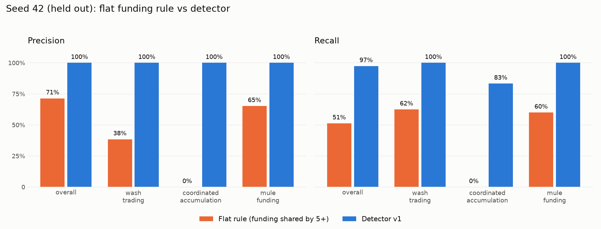
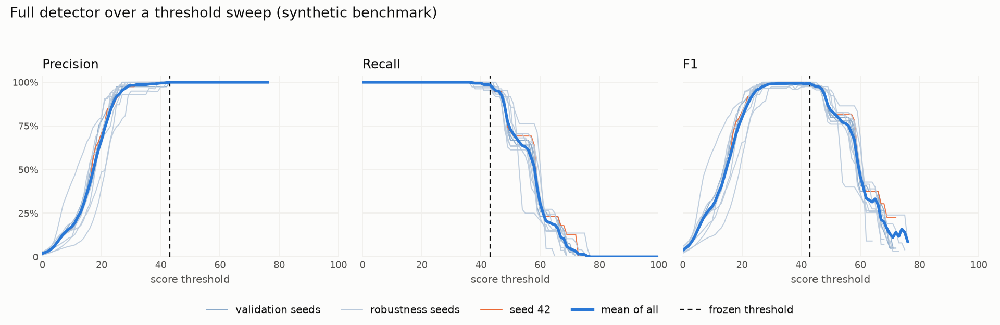

# Benchmark: flat rule vs detector v1

Generated by `scripts/benchmark.py` from `eval.detector_results` (iteration 1).

Data: seed 42, 2,039 accounts, 39 attackers (8 wash, 6 coordination, 25 mule), 23 decoy
accounts in three innocent groups, 40% of attackers without a shared funding source
(ADR 0002). The decoy table and ground truth are read only by the evaluation step.

Baseline: flag every account whose funding source is shared by 5 or more accounts.

Detector: explainable linear score over nine scenario-agnostic features, flag at score >= **43.0**. The threshold was chosen on validation seeds [7, 11, 23] (mean F1 1.0) and frozen before seed 42 was scored.

## Seed 42 (held-out evaluation)

| Group | Method | Flagged | True pos | False pos | Precision | Recall | F1 |
|---|---|---:|---:|---:|---:|---:|---:|
| all_scenarios | Flat rule (funding shared by 5+) | 28 | 20 | 8 | 71% | 51% | 60% |
| all_scenarios | Detector v1 | 38 | 38 | 0 | 100% | 97% | 99% |
| wash_trading | Flat rule (funding shared by 5+) | 13 | 5 | 8 | 38% | 62% | 48% |
| wash_trading | Detector v1 | 8 | 8 | 0 | 100% | 100% | 100% |
| coordinated_accumulation | Flat rule (funding shared by 5+) | 8 | 0 | 8 | 0% | 0% | 0% |
| coordinated_accumulation | Detector v1 | 5 | 5 | 0 | 100% | 83% | 91% |
| mule_funding | Flat rule (funding shared by 5+) | 23 | 15 | 8 | 65% | 60% | 63% |
| mule_funding | Detector v1 | 25 | 25 | 0 | 100% | 100% | 100% |

Per-scenario precision is one-vs-rest: that scenario's true positives over those plus
every flagged account that is not an attacker in any scenario.

## Innocent groups (false positives)

| Group | Accounts | Flat rule flagged | Detector flagged |
|---|---:|---:|---:|
| DG1_household | 5 | 0 | 0 |
| DG2_exchange_cluster | 8 | 8 | 0 |
| DG3_busy_honest | 10 | 0 | 0 |
| normal_accounts | 1977 | 0 | 0 |

## Validation seeds (threshold selection)

| Seed | Method | Precision | Recall | F1 |
|---|---|---:|---:|---:|
| 7 | Flat rule (funding shared by 5+) | 71% | 51% | 60% |
| 7 | Detector v1 | 100% | 100% | 100% |
| 11 | Flat rule (funding shared by 5+) | 71% | 51% | 60% |
| 11 | Detector v1 | 100% | 100% | 100% |
| 23 | Flat rule (funding shared by 5+) | 71% | 51% | 60% |
| 23 | Detector v1 | 100% | 100% | 100% |

## Scenario hint accuracy

`scenario_hint` comes from ring structure (reciprocal matched fills, late one-sided
buying near resolution, funding fan-in into fresh accounts), never from ids. It is
scored against ground truth in the evaluation step only: an alert's true type is the
most common scenario among its members. The rule was rewritten after the seed 42
confusion was known (wash ring hinted as mule_funding), so seed 42 is not a clean
held-out number for the hint; the other seeds were not looked at before the fix.

Seed 42, per alert:

| Alert true type | Members | Hint | Correct |
|---|---:|---|---|
| coordinated_accumulation | 4 | coordinated_accumulation | yes |
| coordinated_accumulation | 2 | coordinated_accumulation | yes |
| mule_funding | 25 | mule_funding | yes |
| wash_trading | 8 | wash_trading | yes |

All other seeds, per attacker scenario (alerts hinted correctly / alerts; accounts in
correctly hinted alerts / accounts in alerts of that type):

| Seed | Split | wash_trading | coordinated_accumulation | mule_funding | decoy-only alerts |
|---:|---|---:|---:|---:|---:|
| 7 | validation | 1/1 | 2/2 | 1/1 | 0 |
| 11 | validation | 1/1 | 2/2 | 1/1 | 0 |
| 23 | validation | 1/1 | 2/2 | 1/1 | 1 |
| 101 | robustness | 1/1 | 2/2 | 1/1 | 0 |
| 102 | robustness | 1/1 | 2/2 | 1/1 | 1 |
| 103 | robustness | 1/1 | 2/2 | 1/1 | 0 |
| 104 | robustness | 1/1 | 2/2 | 1/1 | 0 |
| 105 | robustness | 1/1 | 2/2 | 1/1 | 2 |
| 106 | robustness | 1/1 | 2/2 | 3/3 | 0 |
| 107 | robustness | 1/1 | 2/2 | 1/1 | 2 |
| 108 | robustness | 1/1 | 2/2 | 1/1 | 0 |

Robustness seeds combined: wash_trading 8/8, coordinated_accumulation 16/16, mule_funding 10/10.

Wrong hints on robustness seeds. All are decoy-only needs_review alerts (true type 'none'), so they cannot be correct; the busy-but-honest decoys do show late one-sided buying, which is what the hint reports:

- seed 102: 1-member alert of type none hinted coordinated_accumulation
- seed 105: 1-member alert of type none hinted coordinated_accumulation
- seed 105: 1-member alert of type none hinted coordinated_accumulation
- seed 107: 1-member alert of type none hinted coordinated_accumulation
- seed 107: 1-member alert of type none hinted coordinated_accumulation

## Review band

Accounts scoring in [31.66, 43.0) are not dropped: their ring becomes an
alert with `status = 'needs_review'` (or stays in a flagged ring as an unflagged member;
`n_flagged` counts the members at or above the threshold). Metrics above still count
only accounts at or above 43.0 as flagged. The margin (11.34) is the mean over the
validation seeds of the weakest attacker's score minus the strongest non-attacker's
score, rule fixed before seed 42 was scored. Validation gaps: seed 7 16.7701, seed 11 14.9636, seed 23 2.2922.

| Seed | Split | Attackers in band | Decoys in band | Other accounts in band | Missed attackers in band / missed |
|---:|---|---:|---:|---:|---:|
| 42 | held-out | 1 | 0 | 0 | 1 / 1 |
| 101 | robustness | 1 | 0 | 0 | 1 / 1 |
| 102 | robustness | 0 | 1 | 0 | 0 / 0 |
| 103 | robustness | 1 | 0 | 0 | 1 / 1 |
| 104 | robustness | 0 | 0 | 0 | 0 / 0 |
| 105 | robustness | 1 | 2 | 0 | 1 / 1 |
| 106 | robustness | 1 | 0 | 0 | 1 / 1 |
| 107 | robustness | 1 | 2 | 0 | 1 / 1 |
| 108 | robustness | 0 | 0 | 0 | 0 / 0 |

Seed 42 alert queue: 4 flagged, 0 needs_review.

## Ablation

Each variant gets its own cut-off from the validation seeds [7, 11, 23] with the same plateau-midpoint procedure (mean F1, middle of
the best plateau). Held-out columns use that cut-off unchanged. Graph features:
link_size, link_density, fill_reciprocity, fresh_funding_fanin, fresh_cluster. Behavior
features: account_freshness, late_concentration, size_zscore, timing_zscore. Subset
weights are renormalised to span 0-100. For the two rule variants the cut-off is a group
size (flat rule: funding group of k or more; components: component size). The published
flat rule (k = 5) is in the tables above; here k is re-selected like every other cut-off.

| Variant | Cut-off | Validation F1 | Seed 42 P / R / F1 | Robustness F1 min / median / max | Robustness recall min / median / max |
|---|---:|---:|---|---|---|
| Flat funding rule (group size k) | 3.5 | 68% | 75% / 62% / 68% | 43% / 62% / 74% | 34% / 55% / 73% |
| Device/funding components only | 8 | 79% | 73% / 85% / 79% | 50% / 71% / 92% | 56% / 76% / 92% |
| Graph features only (no behavior) | 40 | 97% | 100% / 95% / 97% | 89% / 97% / 100% | 81% / 94% / 100% |
| Behavior features only (no graph) | 32.5 | 86% | 80% / 100% / 89% | 72% / 81% / 93% | 79% / 90% / 98% |
| Full detector | 43 | 100% | 100% / 97% / 99% | 98% / 99% / 100% | 95% / 98% / 100% |

## Robustness seeds (frozen threshold)

Eight extra synthetic worlds with varied parameters (`evals/robustness_profiles.json`),
scored at the frozen threshold 43.0. Nothing was tuned on them.

| Seed | Wash / coord / mule | Evasion | Decoys (hh / exch / busy) | Trades per account | Device noise | Attackers | Flagged | P | R | F1 | Flat rule P / R |
|---:|---|---:|---|---|---:|---:|---:|---:|---:|---:|---|
| 101 | 5 / 4 / 12 | 20% | 3 / 5 / 6 | 2-15 | 4% | 21 | 20 | 100% | 95% | 98% | 67% / 48% |
| 102 | 12 / 10 / 40 | 60% | 8 / 12 / 14 | 8-50 | 15% | 62 | 62 | 100% | 100% | 100% | 64% / 34% |
| 103 | 6 / 8 / 30 | 30% | 6 / 10 / 12 | 4-30 | 10% | 44 | 43 | 100% | 98% | 99% | 73% / 61% |
| 104 | 10 / 5 / 18 | 50% | 4 / 6 / 8 | 6-40 | 6% | 33 | 33 | 100% | 100% | 100% | 70% / 42% |
| 105 | 7 / 9 / 22 | 60% | 7 / 9 / 14 | 2-15 | 12% | 38 | 37 | 100% | 97% | 99% | 50% / 24% |
| 106 | 9 / 4 / 35 | 20% | 5 / 12 / 6 | 8-50 | 4% | 48 | 47 | 100% | 98% | 99% | 74% / 73% |
| 107 | 5 / 7 / 15 | 45% | 8 / 5 / 10 | 3-20 | 15% | 27 | 26 | 100% | 96% | 98% | 62% / 30% |
| 108 | 12 / 6 / 26 | 35% | 3 / 8 / 12 | 5-35 | 8% | 44 | 44 | 100% | 100% | 100% | 76% / 57% |

Range over the eight seeds (min / median / max):

| Method | Precision | Recall | F1 |
|---|---|---|---|
| Detector | 100% / 100% / 100% | 95% / 98% / 100% | 98% / 99% / 100% |
| Flat rule | 50% / 68% / 76% | 24% / 45% / 73% | 32% / 54% / 74% |

Worst case by F1: **seed 101** (precision 100%, recall 95%, F1 98%).

Missed attackers there (scenario, score): coordinated_accumulation 40.33. Decoy and background accounts flagged: 0.

Precision, recall and F1 of the full detector over a threshold sweep (0-100). Thin lines:
validation seeds, seed 42 and robustness seeds; bold: mean over all of them. Dashed
line: the frozen threshold 43.0. The sweep is descriptive; it did not choose anything.

## Caveats

This is a synthetic benchmark: the scenarios, decoys, generator and detector come from
one project, and the labels say what the generator planted, not what a real market
contains. Nothing below is evidence about real prediction markets.

- **What the robustness seeds test.** Ring sizes, evasion rate (20-60%), decoy group sizes,
  background trade volume and device-sharing noise were varied. The attack types were not:
  the same three scenarios and the same three decoy kinds appear in every seed. The result
  is stability to those parameters, not to a new manipulation tactic or a new kind of
  innocent behaviour.
- **Robustness result.** At the frozen threshold 43.0, precision over the eight seeds was 100% / 100% / 100% and recall 95% / 98% / 100% (min / median / max); worst case seed 101, F1 98%. Every one of the 5 missed attackers scored below the threshold but inside the review band (5 of 5): 2 coordinated_accumulation, 3 mule_funding.
- **The margin is thin where it matters.** Across the robustness seeds the weakest attacker scored 36.79-45.55 and the strongest non-attacker 26.53-41.97 against a threshold of 43.0. On robustness seeds [105, 107] the strongest non-attacker outscored the weakest attacker, so no single cut-off separates them perfectly; the frozen threshold happens to flag no decoy, but it is a few points from the strongest non-attackers and misses attackers in the same range.
- **Weights and threshold.** Weights were set a priori and never fitted. Only the
  threshold was chosen from data, from the validation seeds. Seed 42 and the robustness
  seeds were not used for tuning; the validation seeds' 100% F1 is in-sample for the
  threshold.
- **Review band.** The margin is the mean validation gap, and that gap is dominated by two
  easy seeds (gaps 16.8, 15.0, 2.3). It
  is a heuristic for routing cases to the agents, not a calibrated probability. It also
  routes decoys: see the decoy column of the band table.
- **Hints.** Rewritten after the seed 42 confusion was known, so seed 42 is not held out
  for it. All attacker alerts on the other seeds were hinted correctly, but the hint is a
  three-way decision list built for these three scenarios; a new pattern would be hinted as
  one of them or `unclassified`. A needs_review alert made only of decoys has no correct
  hint by construction.
- **Ablation.** Graph features alone reach robustness F1 89% / 97% / 100% (precision stays 100%); behavior features alone 72% / 81% / 93%; device/funding components only 50% / 71% / 92%; the flat funding rule 43% / 62% / 74%; the full detector 98% / 99% / 100%. Graph structure carries most of the separation and behavior adds the last recall points; neither half is as good alone. The graph/behavior split of features is a judgement made before the runs, and the full-detector row's validation F1 is in-sample.
- The flat rule scores the same on the original seeds because decoys and evasions are
  generated identically there; only the background trades differ.
